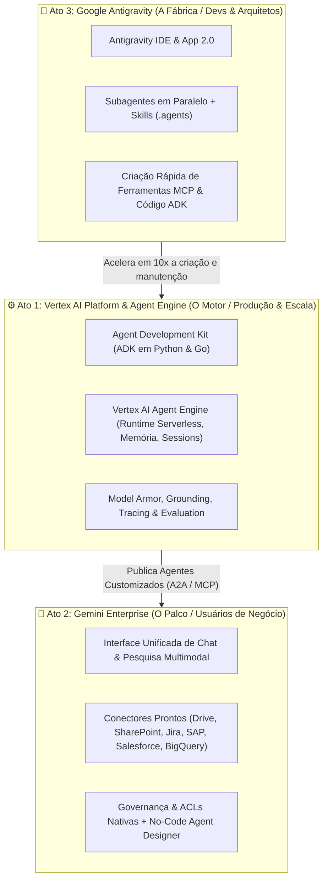

# 🎙️ Playbook de Storytelling Executivo & Casos de Uso Curingas

Este documento estrutura a narrativa de vendas (Storytelling) para apresentar a evolução do ecossistema Google Cloud AI de forma clara, evitando confusão de nomenclaturas para o cliente e posicionando **cada produto na camada certa de valor**.

---

## 🧭 1. O Arco Narrativo: As 3 Ondas da IA Corporativa no Google Cloud

Muitos clientes conhecem o Google Cloud pelo "antigo Vertex AI" (modelos isolados, Dialogflow ou busca simples) e ficam em dúvida sobre onde entram o **Vertex AI atual**, o **Gemini Enterprise** e o **Google Antigravity**.

Use a analogia dos **3 Pilares da Transformação Agêntica**:

---

### 🔹 Ato 1: Do "Antigo Vertex" para a Nova **Plataforma de Agentes Vertex AI** (O Motor)
* **Como era antes ("O Antigo Vertex"):** Foco em treinar modelos de ML tradicionais (AutoML), consumir APIs de LLMs avulsos (PaLM/Gemini inicial) ou criar chatbots baseados em fluxos rígidos (Dialogflow) e RAG básico (Vertex AI Search & Conversation inicial).
* **O que mudou (O Novo Paradigma):** Empresas não querem apenas "conversar com um PDF"; elas precisam de **Sistemas Multi-Agentes que executam ações transacionais com segurança**.
* **Os Protagonistas Técnicos:**
  1. **ADK (Agent Development Kit — Python & Go):** O framework open-source do Google para engenharia de agentes como código real.
     * **Python (`google-adk`):** Perfeito para cientistas de dados e engenheiros de IA criarem orquestradores, pipelines RAG e raciocínio complexo rapidamente.
     * **Go (`google.golang.org/adk/v2`):** Perfeito para times de Backend/Plataforma construírem agentes de altíssima performance, baixa latência, concorrência massiva e integração com microsserviços existentes.
  2. **Protocolos Abertos (MCP & A2A):** Nenhum lock-in. Seus agentes usam **MCP (Model Context Protocol)** para conectar ferramentas e **A2A (Agent2Agent)** para que agentes em Python, Go ou até de terceiros conversem entre si.
  3. **Vertex AI Agent Engine:** O runtime totalmente gerenciado. Você roda um comando (`adk deploy`) e o Google gerencia memória de curto/longo prazo, sessões, escalabilidade automática, avaliação contínua (Evaluation), rastreabilidade (Cloud Trace) e segurança com **Model Armor** (proteção contra prompt injection e vazamento de dados).

> **💡 Frase de Impacto no Pitch (Ato 1):**
> *"No Vertex AI, saímos da era de experimentos em notebooks para a Engenharia de Agentes de missão crítica: seus desenvolvedores escrevem agentes modulares em Python ou Go com o ADK, e o Vertex AI Agent Engine coloca isso em produção em minutos com segurança bancária."*

---

### 🔹 Ato 2: **Gemini Enterprise** (O Palco de Negócios e Governança)
* **A Dor do Cliente:** *"Meus times construíram ótimos agentes no Vertex AI, mas onde o meu diretor financeiro, o analista de RH ou o vendedor acessam isso no dia a dia? Eu preciso criar um frontend do zero para cada agente? E como garanto que o estagiário não veja a planilha de salários da diretoria?"*
* **A Solução (Gemini Enterprise — evolução do Google Agentspace):**
  1. **Ponto Único de Entrada (Single Pane of Glass):** Uma interface web corporativa pronta para uso, onde o colaborador pesquisa em toda a empresa e interage com assistentes.
  2. **Busca Corporativa Multimodal com Conectores Nativos:** Conecta-se em poucos cliques ao Google Workspace, Microsoft 365 / SharePoint, Jira, Confluence, ServiceNow, Salesforce, SAP e BigQuery — **respeitando 100% das permissões (ACLs) originais de cada usuário**.
  3. **Encontro do No-Code com o Pro-Code:** Usuários de negócio podem criar agentes simples sem código (*No-Code Agent Designer*), enquanto os agentes complexos construídos pela TI no **Vertex AI (via ADK Python/Go)** são publicados diretamente na galeria do **Gemini Enterprise**!

> **💡 Frase de Impacto no Pitch (Ato 2):**
> *"Enquanto o Vertex AI é a sua usina de força para construir inteligência sob medida, o Gemini Enterprise é a vitrine governada onde toda a sua empresa consome essa inteligência no dia a dia, conectada ao seu SharePoint, SAP e BigQuery sem escrever uma linha de frontend."*

---

### 🔹 Ato 3: **Google Antigravity** (A Fábrica Acelerada de Engenharia)
* **A Dor do Cliente:** *"Adorei a arquitetura de agentes em Python e Go no Vertex AI e a exposição no Gemini Enterprise, mas meu time de engenharia está sobrecarregado com backlog legado. Quem vai codificar esses agentes, escrever testes, criar conectores MCP e manter tudo isso?"*
* **A Solução (Google Antigravity — IDE, App 2.0, CLI & SDK):**
  1. **Não é apenas um autocompletar de código:** É uma plataforma de desenvolvimento **AI-First e Agêntica**.
  2. **Três Modalidades na IDE + App 2.0:**
     * *Passiva (Tab / Supercomplete):* Predição da próxima intenção e diffs inteligentes no editor.
     * *Instrutiva (`Ctrl+I` / Inline):* Refatoração e geração localizada.
     * *Colaborativa & Autônoma (Antigravity 2.0 & Subagentes):* O engenheiro delega tarefas inteiras (ex: *"Crie um agente em Go no ADK que consulte a API de estoque, escreva os testes unitários e valide na UI local"*). O Antigravity planeja (`/plan`), dispara **Subagentes em paralelo**, roda comandos em um **Terminal Sandbox seguro** e valida a interface usando **Browser Automation**.
  3. **Padronização Corporativa (`.agents/skills` & Rules):** A arquitetura da empresa vira **Skills** dentro do repositório. Qualquer dev júnior constrói agentes seguindo o padrão sênior de segurança e arquitetura da organização.

> **💡 Frase de Impacto no Pitch (Ato 3):**
> *"Para fechar o ciclo: o Vertex AI roda seus agentes, o Gemini Enterprise entrega para o negócio, e o Google Antigravity multiplica por 10 a capacidade do seu time de engenharia (e da nossa consultoria) de construir, testar e evoluir esses sistemas."*

---

## 🧩 2. Matriz de "Casos Genéricos" (Curingas Adaptáveis por Cenário)

Para não precisar reconstruir demos do zero a cada reunião, estruturamos **3 Casos Genéricos (Blueprints)** no projeto `gemini-demo-qi`. Eles usam a **mesma arquitetura de código**, mudando apenas o contexto de negócio:

| Caso Genérico (Blueprint) | O que demonstra na prática | 🛒 Varejo & E-commerce | 🏦 Bancos & Seguros (FSI) | 🏥 Saúde & Operadoras | 🏭 Indústria & Logística |
| :--- | :--- | :--- | :--- | :--- | :--- |
| **Caso A: Concierge de Conhecimento Corporativo (360º Search & Synthesis)** | **Gemini Enterprise UI** + Conectores (Docs, PDFs, BigQuery) + Grounding com citações e controle de acesso. | Consulta de manuais de loja, políticas de troca e performance de vendas regionais. | Análise de normas do BACEN/SUSEP, políticas de crédito e dossiês de compliance. | Protocolos clínicos, auditoria de prontuários/guias TISS e regras de cobertura ANS. | Manuais técnicos de maquinário, normas ISO/NR e histórico de manutenção preventiva. |
| **Caso B: Orquestrador Multi-Agente de Operações (Python ADK + Go ADK)** | **ADK Python** (Orquestrador + Analista de Dados BigQuery) delegando para **ADK Go** (Agente Transacional de alta performance) no **Vertex AI Agent Engine**. | Gestão de rupturas de estoque, recálculo de frete em tempo real e estorno automático de pedido. | Triagem de sinistros/fraudes, cálculo de risco em Go e aprovação de limite/pagamento. | Autorização inteligente de procedimentos médicos, checagem de carência e agendamento. | Reprogramação automática de rota logística, cotação de peças e abertura de ordem no ERP. |
| **Caso C: Fábrica Ágil de Agentes & Modernização (DevEx)** | **Google Antigravity (IDE / App 2.0)** criando uma nova ferramenta MCP ou adaptando o agente ADK ao vivo em 3 minutos. | Criação ao vivo de uma regra de promoção "Black Friday" no agente de vendas. | Criação ao vivo de um validador de PIX/Antifraude como ferramenta MCP em Go. | Criação ao vivo de um parser de laudo médico estruturado em JSON com testes. | Criação ao vivo de um conector para API de telemetria IoT de caminhões. |

---

## 🎯 3. Guia de Qualificação Rápida (Perguntas de Discovery para o Cliente)

Antes ou nos primeiros 10 minutos da reunião, faça estas 3 perguntas para calibrar onde dar mais ênfase na demo:

1. **Foco em Produtividade & Dados Desestruturados?** *(Dores: "Ninguém acha informações nos PDFs/SharePoint/Drive")*
   👉 **60% do tempo no Ato 2 (Gemini Enterprise UI)** + 40% no Ato 1 (Vertex Search/Grounding).
2. **Foco em Automação de Processos Core, Atendimento ou Produtos Digitais?** *(Dores: "Precisamos integrar IA ao nosso ERP/CRM/App com baixa latência e regras rígidas")*
   👉 **60% do tempo no Ato 1 (ADK Python & Go + UI do `adk web` + Vertex AI Agent Engine)** + 20% Ato 2 + 20% Ato 3.
3. **Foco em Eficiência de TI, Modernização de Legado ou Aceleração de Squads?** *(Dores: "Nosso time técnico não dá conta das demandas de negócio")*
   👉 **50% do tempo no Ato 3 (Google Antigravity ao vivo)** construindo e deployando um agente no **Ato 1 (Vertex AI)**.
