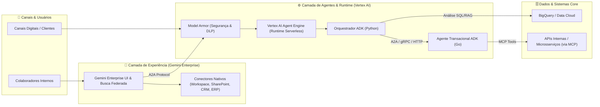

# 📄 Modelo de Proposta Comercial & Roteiro de Implantação (Pós-Demo)

Este documento serve como **Template Base de Proposta Técnica e Comercial** para ser enviado ao cliente logo após a sessão de Storytelling e Demonstração no projeto `gemini-demo-qi`.

> **Dica:** Você pode pedir ao **Google Antigravity** para preencher automaticamente todos os campos entre `[COLCHETES]` com os dados específicos do cliente após a reunião!

---

## 1. Estrutura da Proposta Executiva (Para o Cliente: `[NOME_DO_CLIENTE]`)

### 1.1. Sumário Executivo
A **`[NOME_DO_CLIENTE]`** busca acelerar sua eficiência operacional e capacidade de tomada de decisão no cenário de **`[CENÁRIO: Ex: Atendimento Consultivo / Automação de Backoffice / Gestão do Conhecimento]`**, superando desafios atuais de fragmentação de dados e processos manuais.

A **QI Network**, como parceira especialista Google Cloud, propõe uma arquitetura moderna em **3 camadas integradas**:
1. **Execução & Orquestração Inteligente (Vertex AI Platform & ADK Python/Go):** Agentes modulares com raciocínio determinístico, integrados aos sistemas transacionais e analíticos via **Vertex AI Agent Engine**.
2. **Acesso Unificado & Governança (Gemini Enterprise):** Interface corporativa pronta para o usuário final, conectada às bases de conhecimento com respeito integral às políticas de segurança e permissões (IAM/ACLs).
3. **Aceleração Contínua de Engenharia (Google Antigravity):** Adoção de fluxos de engenharia assistidos por agentes para reduzir em até **60% o tempo de desenvolvimento e manutenção (Time-to-Market)** de novas capacidades.

---

### 1.2. Arquitetura Alvo Proposta

---

## 2. Abordagem de Entrega em 3 Fases (Land & Expand)

Para mitigar riscos, comprovar ROI rapidamente e garantir governança desde o primeiro dia, estruturamos o projeto em **3 ondas incrementais**:

### 🏁 Fase 1: Discovery & Fast-Track MVP (4 Semanas)
* **Objetivo:** Colocar 1 Caso de Uso Prioritário em funcionamento com dados reais controlados e medir valor tangível.
* **Entregáveis:**
  * Setup de Landing Zone de IA segura no GCP (IAM, VPC Service Controls, Model Armor básico).
  * Configuração do **Gemini Enterprise** com até 2 conectores nativos (ex: Google Drive / SharePoint + BigQuery).
  * Desenvolvimento de 1 Sistema Multi-Agente utilizando **ADK (Python + Go)** hospedado no **Vertex AI Agent Engine**.
  * Validação de acurácia com *Vertex AI GenAI Evaluation Service* (Golden Dataset de 50 perguntas/cenários).
* **Critério de Sucesso:** Agente operando em ambiente de Homologação/Piloto com acurácia $\ge 85\%$ e latência dentro do SLA.

### 🚀 Fase 2: Produção, Integração Transacional & Escala (6 a 8 Semanas)
* **Objetivo:** Integrar os agentes aos sistemas core (ERP/CRM/APIs internas via **MCP**), habilitar ações transacionais seguras e liberar para todos os usuários da área de negócio.
* **Entregáveis:**
  * Construção de servidores **MCP (Model Context Protocol)** e microsserviços Agênticos em **Go (`adk/v2`)** para alta concorrência.
  * Esteira CI/CD automatizada para deploy de agentes (`adk deploy` + Cloud Build / GitHub Actions).
  * Observabilidade completa (Cloud Trace, Dashboards de FinOps/Consumo de Tokens, Alertas de Qualidade e Guardrails avançados no Model Armor).
  * Go-Live assistido e treinamento dos usuários de negócio no **Gemini Enterprise**.

### 🏭 Fase 3: Centro de Excelência Agêntico com Google Antigravity (Contínuo / Transferência)
* **Objetivo:** Capacitar a equipe de engenharia do cliente a construir e evoluir novos agentes internamente em velocidade recorde.
* **Entregáveis:**
  * Implantação e configuração do **Google Antigravity** para os squads de desenvolvimento do cliente.
  * Criação do repositório corporativo de **Skills (`.agents/skills/`)** e **Rules** com os padrões de arquitetura, segurança e templates ADK (Python/Go) da empresa.
  * Operação Assistida (Hypercare) e evolução de novos casos de uso.

---

## 3. Checklist Técnico de Implantação (Runbook Pós-Venda)

Quando a proposta é aprovada, a equipe técnica de Delivery utiliza o próprio repositório `data-ai-presales` como acelerador de implantação seguindo os 6 passos abaixo:

### Passo 1: Fundação GCP & Segurança
- [ ] Criar/configurar projeto GCP do cliente (espelhando a configuração do `gemini-demo-qi`).
- [ ] Executar `automation/setup-gemini-demo-qi.sh` ajustando o `PROJECT_ID` do cliente para habilitar as APIs (`aiplatform.googleapis.com`, `discoveryengine.googleapis.com`, `bigquery.googleapis.com`, `modelarmor.googleapis.com`).
- [ ] Configurar Service Accounts com privilégio mínimo para o Vertex AI Agent Engine.

### Passo 2: Ingestão de Dados & Grounding
- [ ] Criar Data Stores no **Vertex AI Search / Gemini Enterprise** apontando para os buckets Cloud Storage, tabelas BigQuery ou conectores SaaS do cliente.
- [ ] Validar a indexação e a propagação de ACLs (permissões por grupo do Google Workspace / Entra ID).

### Passo 3: Adaptação dos Agentes ADK (Python & Go)
- [ ] Utilizar a Skill `.agents/skills/presales-customizer` no **Antigravity** para gerar os contratos de ferramentas (Tools/MCP) alinhados às APIs reais do cliente.
- [ ] Ajustar o `agents/python-orchestrator/agent.py` com as instruções de sistema (System Instructions) e políticas de compliance do cliente.
- [ ] Ajustar o `agents/go-microservice-agent/main.go` para conectar aos endpoints internos de alta performance.

### Passo 4: Avaliação Automatizada (LLMOps)
- [ ] Executar bateria de testes locais via `adk web` e `adk eval`.
- [ ] Validar proteção contra *Prompt Injection* e vazamento de PII via **Model Armor**.

### Passo 5: Deploy no Vertex AI Agent Engine
- [ ] Executar `make deploy-agent-engine PROJECT_ID=<id-cliente>` para empacotar e publicar o agente no runtime gerenciado.
- [ ] Verificar logs e métricas de sessão no Console do Vertex AI Agent Engine.

### Passo 6: Publicação no Gemini Enterprise
- [ ] Registrar o endpoint do Agent Engine no catálogo do **Gemini Enterprise** para disponibilização imediata na interface web dos usuários finais.
